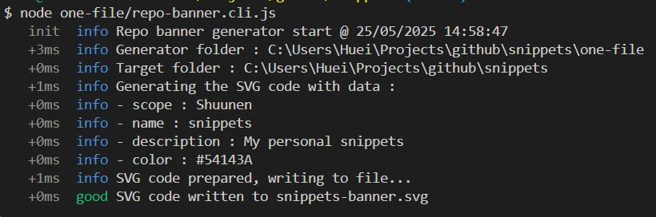

# Snippets

[](https://codeclimate.com/github/Shuunen/snippets)
[](https://github.com/Shuunen/snippets/blob/master/LICENSE)
[](https://hits.sh/github.com/Shuunen/snippets/)



> My personal snippets, tests, and things that are too small to have their own repo :)

## Tools

### Repo Banner

In a terminal, cd to the root of your repo and run:

```bash
node path/to/snippets/src/repo-banner.cli.js
```

Here is the output of the cli running on this repository :



It will generate a `<project-name>-banner.svg` file that you can use in your README.md file, here is the output for this repository :


### Catalog Media

Scan your movie and tv show folders and build a single `catalog-media.html` page, with posters, ratings and the best resolution found for each title.

```bash
# create src/catalog-media.env, see the example in the header of src/catalog-media.cli.ts
bun path/to/snippets/src/catalog-media.cli.ts
```

When a title is in several folders, the copy with the best quality wins. Posters and video resolutions are cached in `src/.cache/catalog-media`, add `--no-cache` to ignore it. Needs `ffprobe` to read resolutions that are not in the file name.

### Bench Drive

Benchmark a drive or a USB key : sequential and random read/write speeds, sustained write speed (size of the fast write cache) and small files rate. Existing data is never touched, a temporary 1 GB file is written, read back with a content check, then deleted.

```bash
bun path/to/snippets/src/bench-drive.cli.ts               # pick a drive interactively
bun path/to/snippets/src/bench-drive.cli.ts /media/my-key # benchmark the drive hosting this folder
```

At the end, a tab-separated row can be copied to paste in your drives spreadsheet. Needs `udevadm` on Linux to detect the drive brand, model and serial.

### Net Scan

Scan every active network of your machine (wifi, ethernet...) and list the living devices with their IP, response time, MAC address and name, like SoftPerfect Network Scanner does. The names you give to devices are stored in a text file, one device per line : `MAC=name (vendor)`.

```bash
bun path/to/snippets/src/net-scan.cli.ts                 # scan continuously, notify when a device appears, use ./net-scan.txt
bun path/to/snippets/src/net-scan.cli.ts my-devices.txt  # use another storage file
bun path/to/snippets/src/net-scan.cli.ts --once          # scan once, print the report and leave
bun path/to/snippets/src/net-scan.cli.ts --help          # show the options
```

Keys : `↑` `↓` select a device, `↵` rename it, `l` turns the live mode on or off, `h` shows or hides the hints column (names, open services...), `n` shows or hides the network column, `q` quits. Works on Linux and Windows, needs `notify-send` on Linux for the desktop notifications.

## Development

```bash
pnpm install
pnpm check
pnpm run test:unit
```

Linting and formatting use [oxlint](https://oxc.rs/docs/guide/usage/linter) + [oxfmt](https://github.com/nicolo-ribaudo/oxfmt), replacing the previous Biome setup.

## Thanks

- [Boxy Svg](https://boxy-svg.com) : simple & effective svg editor
- [Bun](https://bun.sh) : super fast runtime for JavaScript and TypeScript
- [Github](https://github.com) : for all their great work year after year, pushing OSS forward
- [Knip](https://github.com/webpro/knip) : super tool to find & fix problems
- [Oxc](https://oxc.rs) : a lovely super-fast collection of JavaScript tools written in Rust
- [Shields.io](https://shields.io) : nice looking badges to be proud of
- [Shuutils](https://github.com/Shuunen/shuutils) : collection of pure JS utils
- [Svg Omg](https://jakearchibald.github.io/svgomg/) : the great king of svg file size reduction
- [V8](https://github.com/demurgos/v8-coverage) : simple & effective cli for code coverage
- [Vite](https://github.com/vitejs/vite) : super fast frontend tooling
- [Vitest](https://github.com/vitest-dev/vitest) : super fast vite-native testing framework
